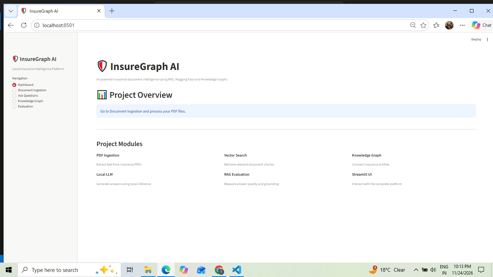
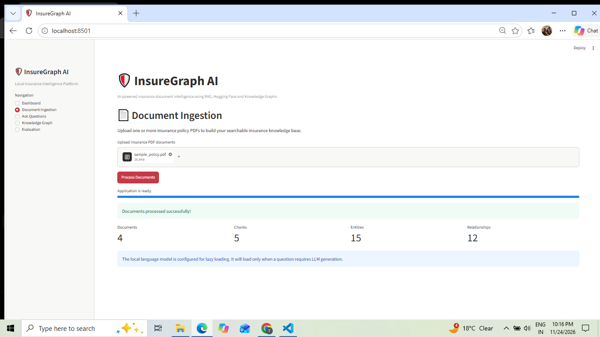
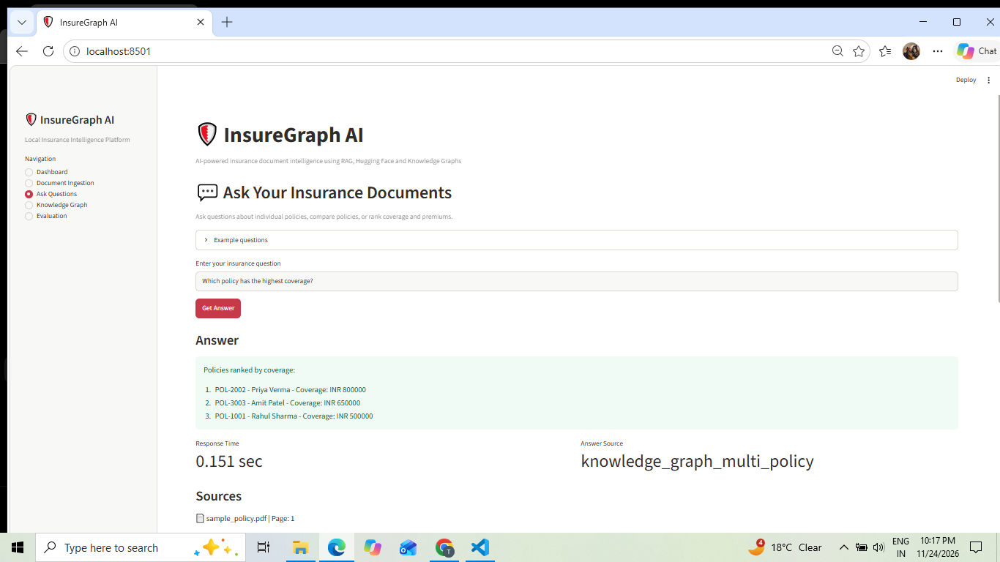

# InsureGraph AI 🛡️

### AI-Powered Insurance Document Intelligence using RAG, Knowledge Graphs, and Hugging Face

InsureGraph AI is an intelligent insurance document analysis system that extracts structured information from insurance policy PDFs, builds a knowledge graph, performs semantic retrieval, and answers questions using evidence-grounded reasoning.

The project combines **Retrieval-Augmented Generation (RAG), Knowledge Graphs, LangChain, LangGraph, and locally running Hugging Face models** to make insurance policy information easier to retrieve, understand, compare, and validate.

---

## 🚀 Key Features

- **PDF Document Ingestion:** Extracts text from insurance policy PDF documents using PyMuPDF.
- **Text Chunking:** Splits extracted documents into manageable chunks for retrieval.
- **Entity Extraction:** Identifies insurance entities such as policies, customers, insurers, premiums, and coverage amounts.
- **Knowledge Graph Construction:** Represents extracted entities and relationships using NetworkX.
- **Semantic Search:** Uses Sentence Transformers embeddings for similarity-based document retrieval.
- **Retrieval-Augmented Generation:** Combines retrieved document evidence and knowledge graph information to answer questions.
- **Multi-Policy Intelligence:** Compares policies, ranks coverage amounts, and identifies the highest coverage and lowest premium.
- **LangGraph Workflow:** Implements a structured retrieval, answering, and validation workflow.
- **Evidence Validation:** Checks generated answers against retrieved document and graph evidence.
- **Interactive Dashboard:** Provides a Streamlit interface for asking questions about insurance documents.
- **Automated Evaluation:** Evaluates the system using a golden dataset of 31 questions.
- **Local Model Support:** Uses Hugging Face models without requiring paid LLM API calls.

---

## 🧠 Technology Stack

| Category | Technologies |
|---|---|
| Programming Language | Python |
| LLM | Qwen2.5-0.5B-Instruct |
| Embedding Model | sentence-transformers/all-MiniLM-L6-v2 |
| LLM Framework | LangChain |
| Agent Workflow | LangGraph |
| Knowledge Graph | NetworkX |
| PDF Processing | PyMuPDF |
| Machine Learning | PyTorch, Transformers |
| Dashboard | Streamlit |
| Data Validation | Pydantic |
| Testing | Pytest |
| Version Control | Git, GitHub |

---

## 🏗️ System Architecture

```text
                 Insurance Policy PDFs
                          |
                          v
                 PDF Document Loader
                          |
                          v
                    Text Chunking
                          |
              +-----------+-----------+
              |                       |
              v                       v
       Entity Extraction        Text Embeddings
              |                       |
              v                       v
       Knowledge Graph          Vector Search
              |                       |
              +-----------+-----------+
                          |
                          v
                     RAG Agent
                          |
                          v
                  LangGraph Workflow
                          |
                          v
                   Answer Validation
                          |
                          v
                  Grounded Response
                          |
                          v
                 Streamlit Dashboard
```

---

## 📊 Knowledge Graph Design

The system models insurance information using entities and relationships.

### Entity Types

- Policy
- Customer
- Insurer
- Premium
- Coverage

### Relationship Types

| Source | Relationship | Target |
|---|---|---|
| Customer | OWNS | Policy |
| Policy | ISSUED_BY | Insurer |
| Policy | HAS_PREMIUM | Premium |
| Policy | HAS_COVERAGE | Coverage |

The knowledge graph enables structured queries and multi-policy reasoning.

---

## 📄 Sample Insurance Dataset

The project currently uses three synthetic insurance policy PDFs for development and evaluation.

| Policy ID | Customer | Insurance Provider | Annual Premium | Coverage |
|---|---|---|---:|---:|
| POL-1001 | Rahul Sharma | ABC Insurance | INR 15,000 | INR 5,00,000 |
| POL-2002 | Priya Verma | SecureLife Insurance | INR 22,000 | INR 8,00,000 |
| POL-3003 | Amit Patel | National Shield Insurance | INR 18,000 | INR 6,50,000 |

All policy information above is synthetic and intended for demonstration and testing.

---

## 💬 Example Questions

The application supports questions such as:

**Single-Policy Questions**
- What is the coverage amount for Rahul Sharma?
- What is the annual premium for Priya Verma?
- Who is the insurer for policy POL-3003?
- Who is the customer of policy POL-1001?

**Multi-Policy Questions**
- Which policy has the highest coverage?
- Which policy has the lowest premium?
- Rank all policies by coverage.
- Rank all policies by premium.
- Compare all insurance policies.
- List all insurance providers.
- List all customers.

---

## 📈 Evaluation Results

The system was tested using a golden dataset containing **31 insurance-related questions** across the three synthetic policy documents.

### Evaluation Metrics

| Metric | Result |
|---|---:|
| Total Evaluation Questions | 31 |
| Answer Accuracy | 100% |
| Policy Retrieval Accuracy | 100% |
| Evidence Grounding Rate | 100% |
| Source-Grounded Answer Accuracy | 100% |

### Evaluation Highlights

- All 31 evaluation questions passed.
- All expected policy documents were retrieved.
- Answers were grounded in the available document and knowledge graph evidence.
- The local LLM was not loaded during this evaluation because supported questions were answered through deterministic graph-based logic.

**Note:** These results are specific to the current synthetic golden dataset and do not represent guaranteed accuracy on unseen or real-world insurance documents.

---

## ⚙️ Installation and Setup

### 1. Clone the Repository

```bash
git clone https://github.com/tanujsinghrajput02/InsureGraph-AI.git
cd InsureGraph-AI
```

### 2. Create a Virtual Environment

```bash
python -m venv venv
```

### 3. Activate the Virtual Environment

For Windows PowerShell:

```powershell
.\venv\Scripts\Activate.ps1
```

### 4. Install Dependencies

```bash
python -m pip install --upgrade pip
pip install -r requirements.txt
```

### 5. Hugging Face Model Access

The project uses Hugging Face models.

The embedding model is:

`sentence-transformers/all-MiniLM-L6-v2`

The local language model is:

`Qwen/Qwen2.5-0.5B-Instruct`

Models are downloaded from Hugging Face when required and cached locally.

A Hugging Face access token can optionally be configured to improve download access and rate limits. Never commit your token or `.env` file to GitHub.

---

## ▶️ Run the Application

Start the Streamlit dashboard:

```bash
streamlit run dashboard/app.py
```

The dashboard allows users to ask questions about insurance policies and inspect retrieved information and graph evidence.

---

## 🧪 Run Evaluation

Run the RAG evaluation:

```bash
python -m src.evaluation.rag_evaluation
```

The evaluation results are saved to:

```text
outputs/rag_evaluation_results.json
```

Run the test suite:

```bash
pytest -v
```

---

## 📁 Project Structure

```text
InsureGraph-AI/
│
├── dashboard/
│   └── app.py
│
├── data/
│   ├── documents/
│   │   ├── sample_policy.pdf
│   │   ├── sample_policy_2.pdf
│   │   └── sample_policy_3.pdf
│   │
│   └── golden_dataset/
│       ├── extraction_golden.json
│       └── rag_golden.json
│
├── src/
│   ├── agent/
│   │   ├── model_manager.py
│   │   ├── rag_agent.py
│   │   ├── run_agent.py
│   │   └── langgraph_workflow/
│   │
│   ├── embeddings/
│   ├── evaluation/
│   ├── extraction/
│   ├── ingestion/
│   ├── knowledge_graph/
│   └── retrieval/
│
├── scripts/
├── tests/
├── outputs/
│
├── requirements.txt
├── .gitignore
└── README.md
```

---

## 🔐 Security and Data Handling

- Environment files and API tokens are excluded from version control.
- Virtual environments and downloaded model weights are excluded from Git.
- Sample policy documents contain synthetic demonstration data.
- No paid external LLM API is required for the demonstrated local workflow.

---

## 🔮 Future Improvements

- Expand the golden dataset with more diverse insurance policy documents.
- Add precision, recall, and F1 evaluation for entity extraction.
- Introduce more advanced LLM-as-a-judge evaluation.
- Add persistent vector database and graph database storage.
- Improve support for complex multi-document questions.
- Add additional insurance document formats.
- Improve model efficiency for CPU-based deployment.
- Expand automated regression and integration testing.

---

## 👨‍💻 Author

**Tanuj Singh Rajput**

GitHub: [@tanujsinghrajput02](https://github.com/tanujsinghrajput02)

Project Repository: [InsureGraph-AI](https://github.com/tanujsinghrajput02/InsureGraph-AI)

---

⭐ If you find this project interesting, feel free to explore the repository and its implementation.

**InsureGraph AI — Turning Insurance Documents into Structured, Searchable Intelligence.**
## 🖥️ Application Screenshots

### 1. Dashboard Overview
The main dashboard provides navigation to document ingestion, insurance questions, knowledge graph exploration, and evaluation.



### 2. Document Ingestion
Upload insurance policy PDFs and process them to extract information and build the searchable knowledge base.



### 3. Insurance Question Answering
Ask questions about insurance policies and receive answers grounded in the knowledge graph, with source information.

